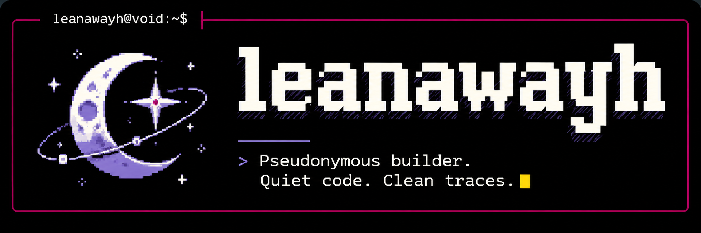

<div align="center">



</div>

<h3 align="center">leanawayh</h3>

<p align="center">Learning by building, one line at a time.</p>

<p align="center">
  
  
</p>

### Currently learning

- **JavaScript** · learning now
- **TypeScript** · up next
- **Rust** · up next

```text
┌─ leanawayh ───────────────────┐
│ $ build                         │
│ > curiosity.exe                 │
│ > status: learning              │
└─────────────────────────────────┘
